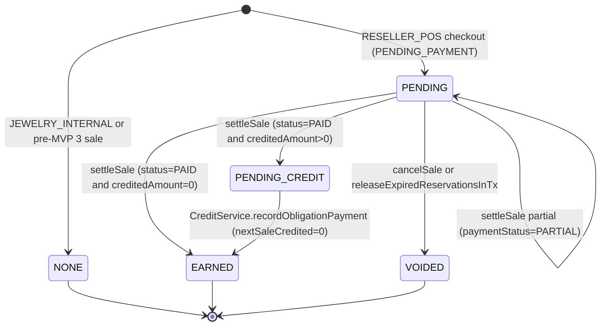

# Reseller POS — Frozen Spread Margins, Credit-Gated Recognition & Drift-Safe Quotes (MVP 3)

*   **Author:** chessco
*   **Status:** Accepted
*   **Date:** 2026-11-18

--------------------------------------------------------------------------------

## Overview

MVP 3 introduces commercial quote previews (`POST /reseller/quotes`) and read-only resale margin reporting (`GET /reseller/commissions`) for the `RESELLER_POS` channel in LuxuryOS (`api/src/commerce`, `api/src/reseller-pos`, `reseller-web`, and admin `PosSales` views).

Under this design, Cared continues billing internal showroom sales (`JEWELRY_INTERNAL`) at List Price (`CommerceProduct.unitPrice`, Precio 1) and reseller sales (`RESELLER_POS`) at Reseller Price (`CommerceProduct.resellerPrice ?? unitPrice`, Precio 2). At `RESELLER_POS` checkout, each `CommerceSaleItem` preserves its billed Precio 2 fields (`unitPrice`, `lineTotal`) while freezing Precio 1 (`publicUnitPrice`) and the unit resale margin `max(0, publicUnitPrice - unitPrice)` in new nullable columns. Margin counts as earned (`commissionStatus = EARNED`) only once Caja has settled the sale (`status = PAID`) and zero credit balance remains (`creditedAmount === 0`). All margin fields stay hidden from store cashiers (`Role.VENDEDOR`).

### Glossary

*   **Cared**: The tenant or merchant entity operating the LuxuryOS platform.
*   **Caja**: The physical store point of sale managed via `web/src/pages/PosSales.tsx`, where cashiers (`Role.VENDEDOR`) and administrators settle sales and record credit repayments.
*   **Precio 1 (P1)**: Public list price (`CommerceProduct.unitPrice`), billed on `JEWELRY_INTERNAL` store sales.
*   **Precio 2 (P2)**: Reseller wholesale price (`CommerceProduct.resellerPrice ?? unitPrice`), billed on `RESELLER_POS` sales.
*   **Margen de reventa**: The frozen spread `max(0, P1 - P2)` per unit and per line, stored in `commissionUnitAmount` and `commissionAmount`.
*   **`unitCost` / `wholesalePrice`**: Internal acquisition cost and wholesale tier price on `CommerceProduct`, strictly hidden from resellers and floor cashiers.
*   **`reseller-web`**: The client-facing reseller portal SPA (`reseller-web/`).
*   **`web`**: The internal back-office and Caja SPA (`web/`).
*   **`CreditAccount` / `CreditObligation`**: A customer credit line and an individual 30-day obligation created when settling a sale via credit. `REVOLVING` and `NON_REVOLVING` are the only `CreditFacilityType` values. `nextSaleCredited` is the remaining `creditedAmount` on the sale after a credit payment is applied.
*   **MVP 1–2**: Completed reseller milestones (catalog/checkout and credit accounts/obligations). **MVP 3**: Current milestone (frozen resale margins, credit-gated recognition, drift-safe quotes). **MVP 4**: Planned future milestone (refund clawbacks, automated disbursement batches, configurable rules).
*   **EGM**: Elephant-Goldfish Model documentation architecture.
*   **Terminology conventions**: Use "sale(s)" / `CommerceSale` rather than "order(s)"; use "mixed cash + credit" instead of `MIXED`; use "workshop `Quote` model and `Order.type = QUOTE`" instead of `model Quote (OrderType.QUOTE)`; and define `commerce.service.ts#cart()` as merging duplicate `productId` lines.

--------------------------------------------------------------------------------

## The Problem

1. **No frozen retail benchmark or margin ledger on reseller sales:** `CommerceService.checkout` snapshots only the billed Precio 2 into `CommerceSaleItem.unitPrice`, while `PATCH /commerce/products/:id` mutates `CommerceProduct.unitPrice` (Precio 1) and `resellerPrice` (Precio 2) in place. Post-hoc joins against `CommerceProduct` cannot recover the retail price or resale spread that existed when a sale was placed.
2. **Uncollected credit treated identically to cash in `CommerceSale.status`:** `CommerceService.settleSale` sets `CommerceSale.status = PAID` immediately when 100% of `totalAmount` is covered by 30-day `REVOLVING` or `NON_REVOLVING` credit (`paidAmount = 0`, `creditedAmount = totalAmount`). Recognizing margin solely on `status === PAID` marks resellers as having earned margin before Cared collects payment on the underlying `CreditObligation`.
3. **Price and stock drift between quoting and checkout without inventory starvation:** Resellers need to quote public prices, reseller prices, estimated resale margins, and current availability to buyers without locking shared inventory via `InventoryReservation`. Conversely, leaving carts detached from server validation lets cached `sessionStorage` drafts in `reseller-web` submit outdated prices or stock counts to `POST /reseller/sales`.
4. **Role and channel boundaries:** `CommerceSale.resellerId` stores the acting cashier ID on `JEWELRY_INTERNAL` sales as well as the reseller ID on `RESELLER_POS` sales. Reporting without channel filtering leaks internal sales, while exposing reseller spreads to `Role.VENDEDOR` in `PosSales.tsx` creates settlement confusion and leaks reseller profit data at the counter.

## Goals

*   Preserve `JEWELRY_INTERNAL` billing at List Price (`Precio 1`) and `RESELLER_POS` billing at Reseller Price (`Precio 2`) without changing `CommerceSaleItem.unitPrice`, `lineTotal`, or `CommerceSale.totalAmount` semantics.
*   Freeze `publicUnitPrice`, `commissionUnitAmount`, and `commissionAmount` on `RESELLER_POS` `CommerceSaleItem` rows (plus `publicTotalAmount`, `commissionAmount`, `commissionStatus`, and `commissionEarnedAt` on `CommerceSale`) using cent-exact math in additive, rollback-safe MySQL 8 DDL with zero historical DML backfill.
*   Restrict `EARNED` margin recognition to `RESELLER_POS` sales where `status === PAID` and `creditedAmount === 0`, holding credit-settled sales in `PENDING_CREDIT` until `CreditService.recordObligationPayment` reduces `creditedAmount` to `0`.
*   Provide a stateless `POST /reseller/quotes` endpoint (`200 OK`, zero `InventoryReservation` locks, zero `model Quote` writes) backed by the same pure server pricing helper as `GET /reseller/catalog` and `checkout()`, returning a SHA-256 `quoteFingerprint` (over prices only) verified at `POST /reseller/sales` so price or stock changes return `409 Conflict` before creating a sale or consuming `Idempotency-Key`.
*   Expose currency-grouped, date-range-filtered, paginated `GET /reseller/commissions` reporting for `REVENDEDOR` (self-only) and `TENANT_ADMIN` / `SYSTEM_ADMIN`, backed by composite indexes on `[tenantId, salesChannel, createdAt]` and `[tenantId, salesChannel, resellerId, createdAt]`, while stripping all margin data from `Role.VENDEDOR` responses and UI views.

## Non-Goals

*   Disbursement batches, cash payouts from Caja, or applying resale margin as a credit offset against `CreditObligation` debt.
*   Configurable per-category or percentage commission rules engine (spread `max(0, Precio 1 - Precio 2)` is the sole formula in MVP 3).
*   Allowing store cashiers (`Role.VENDEDOR`) to view reseller profit margins in `PosSales.tsx` or `/commerce/sales*`.
*   Persisting commercial quotes in workshop `model Quote` (`OrderType.QUOTE`) or blocking inventory during quote preview.
*   Post-`PAID` refunds or partial return clawbacks (deferred to MVP 4).

## Open Questions

None currently open. All four upstream architectural questions (`Precio 1` vs `Precio 2` billing split, credit-gated earning at `creditedAmount === 0`, `POST /reseller/quotes` drift detection via `quoteFingerprint`, and excluding `Role.VENDEDOR` from margin visibility) were resolved in [reseller_pos_commissions_quotes_rfc.md](./reseller_pos_commissions_quotes_rfc.md).

--------------------------------------------------------------------------------

## Critical User Journeys (CUJs)

### CUJ 1: Reseller Quotes Items and Detects Mid-Flight Price or Stock Changes Before Checkout

*   **Given**: A `REVENDEDOR` user browses `reseller-web` for active `availableToResellers = true` SKUs in the same currency.
*   **When**:
    1. The reseller runs a quote via `POST /reseller/quotes` (receiving live `publicUnitPrice`, `unitPrice`, `unitMargin`, `availableQuantity`, `reservesInventory: false`, and `quoteFingerprint`), optionally enables "Vista para cliente" to hide P2 and margin when showing the screen to buyers.
    2. Before checkout, another transaction either updates `unitPrice`/`resellerPrice` via `PATCH /commerce/products/:id` or depletes shared stock.
    3. The reseller confirms `POST /reseller/sales` passing `expectedQuoteFingerprint`.
*   **Then**: No `InventoryReservation` rows are created during the quote step; expired holds do not falsely mark stock unavailable; and if either prices or sufficient availability changed before checkout, `POST /reseller/sales` returns `409 Conflict` (with code `INSUFFICIENT_STOCK` and structured conflicts, or code `QUOTE_DRIFT` with empty conflicts and `currentQuote`). The `Idempotency-Key` remains unconsumed so the reseller can review live diffs and retry with the updated quote.

### CUJ 2: Margin Lifecycle Across Caja Cash Settlement and 30-Day Credit Repayment

*   **Given**: A `REVENDEDOR` submits a valid `RESELLER_POS` sale totaling `Precio 2` with frozen positive spreads (`publicUnitPrice > unitPrice`).
*   **When**:
    1. Checkout completes (`status = PENDING_PAYMENT`), or Caja records a partial payment (`status = PENDING_PAYMENT`, `paymentStatus = PARTIAL`). If cancellation or 30-minute reservation expiry triggers on an unsettled sale, the sale transitions to `CANCELLED` or `EXPIRED`.
    2. Caja/admin settles 100% via cash/card/transfer (`settleSale` -> `status = PAID`, `creditedAmount = 0`).
    3. Alternatively, Caja/admin settles via 30-day credit (`status = PAID`, `creditedAmount > 0`), and later records payments in `CreditService.recordObligationPayment` until `creditedAmount` reaches `0` (`nextSaleCredited === 0`).
*   **Then**:
    1. `commissionStatus` stays `PENDING` during partial payments; on cancellation or 30-minute expiry of a `PENDING` reseller sale, transitions to `VOIDED` with 0 earned margin.
    2. Full non-credit settlement atomically transitions `commissionStatus` to `EARNED`, stamps `commissionEarnedAt`, and increments `EARNED` totals in `GET /reseller/commissions`.
    3. Credit-settled sales enter `PENDING_CREDIT` at `settleSale` (`commissionEarnedAt = null`) and atomically promote to `EARNED` inside `recordObligationPayment` on the final payment where `nextSaleCredited === 0`.

### CUJ 3: Role-Isolated Margin Reporting and Cashier Blinding

*   **Given**: `PAID` `RESELLER_POS` sales exist across multiple resellers and currencies (`MXN`, `USD`) alongside `JEWELRY_INTERNAL` store sales created by `Role.VENDEDOR`.
*   **When**: A `REVENDEDOR` queries `GET /reseller/commissions` (or attempts cross-reseller `?resellerId=<otherId>`), a `TENANT_ADMIN` queries `GET /reseller/commissions?resellerId=...&from=...&to=...` or opens a `RESELLER_POS` sale in `PosSales.tsx`, and a `Role.VENDEDOR` loads `GET /commerce/sales` or settles a `RESELLER_POS` sale in `PosSales.tsx`.
*   **Then**: `REVENDEDOR` sees only their own `RESELLER_POS` sales and margins; if `?resellerId` is present and differs from `actor.id`, the server throws `ForbiddenException`; internal `unitCost` and `wholesalePrice` are omitted. `TENANT_ADMIN` sees currency-grouped totals (`totalsByCurrency`) and paginated `RESELLER_POS` sales excluding `JEWELRY_INTERNAL` sales. `Role.VENDEDOR` receives no `publicUnitPrice`, `publicTotalAmount`, `commissionUnitAmount`, `commissionAmount`, `commissionStatus`, or `commissionEarnedAt` in API responses or UI drawer, while collecting exact `totalAmount` (`Precio 2`) and `balanceDue`.

--------------------------------------------------------------------------------

## Technical Plan (Architecture)

### 1. Data Model & Additive MySQL 8 Migration (`api/prisma/schema.prisma`)

To freeze `Precio 1` (retail benchmark) and `Precio 2` (reseller wholesale price) without altering existing `unitPrice` / `lineTotal` billing invariants or running historical DML backfills:

*   **New enum `CommerceCommissionStatus`**: `NONE`, `PENDING`, `PENDING_CREDIT`, `EARNED`, `VOIDED`.
*   **`CommerceSaleItem` (nullable additive columns)**:
    *   Keep `unitPrice Decimal @db.Decimal(10, 2)` and `lineTotal Decimal @db.Decimal(10, 2)` as the billed channel transaction price (`Precio 2` on `RESELLER_POS`; `Precio 1` on `JEWELRY_INTERNAL`).
    *   Add `publicUnitPrice Decimal? @db.Decimal(10, 2)` — frozen `CommerceProduct.unitPrice` (`Precio 1`) at checkout (`NULL` on `JEWELRY_INTERNAL` and pre-MVP 3 historical rows).
    *   Add `commissionUnitAmount Decimal? @db.Decimal(10, 2)` — frozen per-unit spread `max(0, publicUnitPrice - unitPrice)` computed in integer cents.
    *   Add `commissionAmount Decimal? @db.Decimal(10, 2)` — frozen line total `commissionUnitAmount * quantity`.
*   **`CommerceSale` (nullable totals + status enum with `DEFAULT NONE`)**:
    *   Add `publicTotalAmount Decimal? @db.Decimal(12, 2)` — sum of `publicUnitPrice * quantity`.
    *   Add `commissionAmount Decimal? @db.Decimal(12, 2)` — sum of item `commissionAmount`.
    *   Add `commissionStatus CommerceCommissionStatus @default(NONE)` — `NONE` on historical and `JEWELRY_INTERNAL` rows; initialized to `PENDING` on new `RESELLER_POS` checkouts.
    *   Add `commissionEarnedAt DateTime?` — stamped when Caja settlement or final credit repayment fulfills `status === PAID && creditedAmount === 0`.
    *   Add MySQL-safe composite indexes (`<= 64` char mapped names):
        *   `@@index([tenantId, salesChannel, createdAt], map: "CommerceSale_channel_created_idx")`
        *   `@@index([tenantId, salesChannel, resellerId, createdAt], map: "CommerceSale_reseller_created_idx")`

### 2. Pure Pricing, Margin & `quoteFingerprint` Engine (`api/src/commerce/commerce-pricing.util.ts`)

A pure, Prisma-free utility module shared across catalog serialization, `POST /reseller/quotes`, and `CommerceService.checkout` ensures the four backend endpoints compute identical prices:

*   **Per-unit integer-cent calculation (`evaluateProductMargin`)**:
    *   `toCents = (v) => Math.round((Number(v) + Number.EPSILON) * 100)`
    *   `publicCents = toCents(product.unitPrice)`
    *   `resellerCents = toCents(product.resellerPrice ?? product.unitPrice)`
    *   `unitCommissionCents = Math.max(0, publicCents - resellerCents)` (clamped per unit so a misconfigured SKU never erases spread on another SKU).
*   **Multi-line cart & `quoteFingerprint` (`evaluateResellerCart`)**:
    *   Merges duplicate `productId` lines using shared `mergeCartLines()`.
    *   Enforces single currency across all items (`BadRequestException` if `new Set(currencies).size > 1`).
    *   Computes `lineCommissionCents = unitCommissionCents * quantity`, `publicTotalCents`, `resellerTotalCents`, and `commissionTotalCents`.
    *   Produces canonical SHA-256 `quoteFingerprint` over prices only: lines sorted by `productId`, hashing `productId:quantity:currency:publicCents:resellerCents` joined with `|`.

### 3. Quote Preview (`POST /reseller/quotes`) & Drift-Safe Checkout (`POST /reseller/sales`)

```mermaid
sequenceDiagram
    participant R as Reseller (reseller-web)
    participant Q as POST /reseller/quotes
    participant P as commerce-pricing.util.ts + MySQL
    participant S as POST /reseller/sales
    participant A as Caja/Admin
    participant IP as POST /commerce/sales/:id/settle
    participant K as CreditService

    R->>Q: items[{productId, quantity}]
    Q->>P: computeEffectiveAvailability (read-only, discounts expired holds)
    P-->>Q: Prices (P1, P2), margins, availability, SHA-256 quoteFingerprint
    Q-->>R: 200 OK (reservesInventory=false)
    R->>S: items + expectedQuoteFingerprint + Idempotency-Key
    S->>P: releaseExpiredReservationsInTx(tenantId, { productIds })
    S->>P: Verify live quoteFingerprint and stock in tx
    alt Stock insufficient or SKU disabled
        S-->>R: 409 Conflict (code: INSUFFICIENT_STOCK, conflicts[{productId, reason}])
    else Prices drifted
        S-->>R: 409 Conflict (code: QUOTE_DRIFT, currentQuote, conflicts=[])
    else Prices match and stock available
        S-->>R: 201 Created (PENDING_PAYMENT, commissionStatus=PENDING, 30m reservation)
    end
    A->>IP: Settle sale
    alt 100% Cash/Card/Transfer (creditedAmount = 0)
        IP-->>A: status=PAID, commissionStatus=EARNED
    else Settled via 30-day Credit (creditedAmount > 0)
        IP-->>A: status=PAID, commissionStatus=PENDING_CREDIT
        A->>K: POST /commerce/credit/obligations/:id/payments
        K-->>A: Payment applied; when nextSaleCredited=0 -> commissionStatus=EARNED
    end
```

*   **Read-Only Availability Calculation (`computeEffectiveAvailability`)**: A read-only helper `computeEffectiveAvailability(prisma, tenantId, productIds)` calculates `stockOnHand - reservedQuantity + Σ(quantity of ACTIVE holds with expiresAt <= now on PENDING_PAYMENT sales with paidAmount = 0)`. `getCatalog`, `getInventory`, and `calculateResellerQuote` reuse this helper without acquiring row locks or creating audit entries. `ReservationExpiryService` continues sweeping expired reservations tenant-wide every 60 s (`RESERVATION_EXPIRY_INTERVAL_MS = 60_000`).
*   **`POST /reseller/quotes` (`@HttpCode(HttpStatus.OK)`)**: Stateless calculator (`ResellerPosController`, roles `REVENDEDOR | TENANT_ADMIN | SYSTEM_ADMIN`). Does not require `Idempotency-Key`, does not touch workshop `Quote` model, and creates no `InventoryReservation`. If stock falls short, returns `200 OK` with `isAvailable: false`, `availableQuantity`, `shortageQuantity`, and `allItemsAvailable: false`.
*   **`POST /reseller/sales` & Transaction Order**:
    1. Look up `prior` by `replayWhere` and replay if found.
    2. Tenant-wide expired hold release: call `releaseExpiredReservationsInTx(tx, tenantId, { productIds })` to free expired reservations on cart SKUs.
    3. Price and stock evaluation: load products, compute quote, check stock and compare `expectedQuoteFingerprint` with live fingerprint.
       - Precedence: If any SKU is short or disabled/inactive, throw `ConflictException` with `code: 'INSUFFICIENT_STOCK'` and structured `conflicts: [{ productId, sku, reason: 'INSUFFICIENT_STOCK' | 'UNAVAILABLE', requestedQuantity, availableQuantity }]`.
       - If stock is sufficient but fingerprint drifted, throw `ConflictException` with `code: 'QUOTE_DRIFT'`, `conflicts: []`, and `currentQuote`.
       - Compatibility: `expectedQuoteFingerprint` is optional for one release to maintain backward compatibility during the API -> reseller-web deploy sequence. If omitted, validates stock only. The new `reseller-web` always sends it.
       - Because `409` throws before `commerceSale.create`, the transaction rolls back and `CommerceSale.idempotencyKey` remains unpersisted, leaving `Idempotency-Key` reusable for confirmation retry.
    4. Creation: call `commerceSale.create` (freezing `publicUnitPrice`, `commissionUnitAmount`, `commissionAmount`, `publicTotalAmount`, `commissionAmount`, `commissionStatus: PENDING`), then create reservations.

### 4. Commission Lifecycle State Machine



*   **Precondition Guard**: Apply this precondition to every commission transition in `settleSale`, `cancelSale`, and `releaseExpiredReservationsInTx`: `salesChannel === RESELLER_POS && commissionStatus === PENDING` (or `PENDING_CREDIT`). Historical and `JEWELRY_INTERNAL` rows (`NONE`) remain untouched.
*   **Partial settlements (`PARTIAL`)**: Keep `status = PENDING_PAYMENT` and `commissionStatus = PENDING` until remaining balance settles 100%.
*   **Credit-settled sales (`PENDING_CREDIT -> EARNED`)**: Inside `CreditService.recordObligationPayment` (`api/src/commerce/credit.service.ts#L1037-L1134`):
    *   Extend the select at L1037 with `commissionStatus: true, commissionAmount: true`.
    *   `const promoteCommission = nextSaleCredited === 0 && obligation.sale.commissionStatus === CommerceCommissionStatus.PENDING_CREDIT;`
    *   Inside the compare-and-swap update on `CommerceSale`, set `commissionStatus: EARNED` and `commissionEarnedAt: now` (reusing `now` from L1059) strictly when `promoteCommission` is true.
    *   Emit commission promotion metadata in both `creditLedgerEntry.metadata` and `commerceAuditLog.payload` with action `CREDIT_OBLIGATION_PAID` / `CREDIT_PAYMENT_RECORDED`.
*   **Credit Currency Check**: In `CreditService.applySaleCreditDrawdownsInTx`, throw `BadRequestException('La moneda de la venta no coincide con la cuenta de crédito')` if `account.currency !== params.currency`.
*   **Voided sales & concurrent settlement fixes**:
    *   Both `CommerceService.cancelSale` and `releaseExpiredReservationsInTx` check `candidate.commissionStatus === PENDING` before transitioning `commissionStatus: VOIDED` and recording `{ voidedCommissionAmount }` in `CommerceAuditLog`. Otherwise, keep exact `{ status: EXPIRED }` so existing specs continue passing.
    *   The `catch (P2002)` block in `settleSale` (`commerce.service.ts#L1425-L1440`) verifies `this.prisma.creditObligation?.findFirst({ where: { tenantId: session.tenantId, saleId, idempotencyKey: \`${saleId}:${sha256(key)}:0\` }, select: { id: true } })` to support idempotent credit-only replays.

### 5. Role-Isolated Reporting (`GET /reseller/commissions`) & Cashier Blinding

*   **Service Placement**: `calculateResellerQuote` and `listResellerCommissions` reside in `ResellerPosService` (`api/src/reseller-pos/reseller-pos.service.ts`), while `CommerceService` maintains core checkout and settlement transactions.
*   **API Serializer Blinding (`CommerceService.toSaleResponse(sale, actorRole: Role)`)**: The `actorRole` parameter is non-optional. Retail benchmark and margin fields (`publicUnitPrice`, `publicTotalAmount`, `commissionUnitAmount`, `commissionAmount`, `commissionStatus`, `commissionEarnedAt`) are included only if `[Role.REVENDEDOR, Role.TENANT_ADMIN, Role.SYSTEM_ADMIN].includes(actorRole)`. Pass `session.role` across all 9 call sites in `commerce.service.ts`.
*   **Catalog Blinding**: `CommerceService.catalog()` omits `resellerPrice` and `wholesalePrice` when `session.role === Role.VENDEDOR`.
*   **`GET /reseller/commissions` Query & Scoping**:
    *   Enforces `tenantId = actor.tenantId`, `salesChannel = SalesChannel.RESELLER_POS`, and `commissionStatus != CommerceCommissionStatus.NONE`.
    *   When `actor.role === Role.REVENDEDOR`: if `query.resellerId` is present and differs from `actor.id`, throw `ForbiddenException`. Otherwise force `resellerId = actor.id`. Strips internal `unitCost` and `wholesalePrice`.
    *   `from` and `to` filter **`CommerceSale.createdAt`** across all statuses. They are full ISO-8601 strings with timezone offset (`@IsISO8601({ strict: true })`). If `from > to`, throw `400 Bad Request`.
    *   `status` accepts only `'PENDING' | 'PENDING_CREDIT' | 'EARNED' | 'VOIDED'`. It filters `items`, **not** `totalsByCurrency`.
    *   `totalsByCurrency` groups by `currency` via SQL `groupBy` covering all non-`NONE` reseller sales within the tenant, reseller, and date scope, returning `{ currency, pending, pendingCredit, earned, voided }`.
*   **Caja Admin UI (`web/src/pages/PosSales.tsx`)**:
    *   Inside the sale drawer (`selectedSale`), display the read-only reseller margin summary (`Precio público (P1)`, `Margen revendedor`, `commissionStatus`) gated on `isCreditAdmin` (`TENANT_ADMIN | SYSTEM_ADMIN`) when `salesChannel === 'RESELLER_POS'`.
    *   `Role.VENDEDOR` sees only list price, reseller price (as billed unit price), total, and balance due. Spanish status labels: Pendiente, Pendiente de crédito, Ganado, Anulado.

### 6. HTTP Contracts (canonical)

Canonical TypeScript interfaces shared across backend and frontend contracts:

```typescript
export interface ResellerCatalogItemResponse {
  id: string;
  sku: string;
  name: string;
  description?: string;
  category: string;
  currency: string;
  unitPrice: number;        // P2 (reseller wholesale price)
  publicUnitPrice: number;  // P1 (public list price)
  estimatedMargin: number;  // max(0, P1 - P2)
  stockOnHand: number;
  availableQuantity: number;
  imageUrl?: string;
}

export interface ResellerInventoryItemResponse extends ResellerCatalogItemResponse {
  reservedQuantity: number;
}

export interface ResellerQuoteRequest {
  items: Array<{ productId: string; quantity: number }>;
}

export interface ResellerQuoteLineResponse {
  productId: string;
  sku: string;
  name: string;
  quantity: number;
  currency: string;
  publicUnitPrice: number;  // P1
  unitPrice: number;        // P2
  unitMargin: number;       // max(0, P1 - P2)
  lineMargin: number;       // unitMargin * quantity
  availableQuantity: number;
  isAvailable: boolean;
  reason: 'OK' | 'INSUFFICIENT_STOCK' | 'UNAVAILABLE';
}

export interface ResellerQuoteResponse {
  currency: string;
  lines: ResellerQuoteLineResponse[];
  publicTotal: number;
  total: number;
  marginTotal: number;
  allItemsAvailable: boolean;
  reservesInventory: false;
  quoteFingerprint: string; // SHA-256 over prices only
}

export interface ResellerQuoteConflictResponse {
  code: 'INSUFFICIENT_STOCK' | 'QUOTE_DRIFT';
  message: string;
  currentQuote: ResellerQuoteResponse;
  conflicts: Array<{
    productId: string;
    sku: string;
    reason: 'INSUFFICIENT_STOCK' | 'UNAVAILABLE';
    requestedQuantity: number;
    availableQuantity: number;
  }>;
}

export type ResellerCommissionStatus = 'PENDING' | 'PENDING_CREDIT' | 'EARNED' | 'VOIDED';

export interface ResellerCommissionCurrencySummary {
  currency: string;
  pending: number;
  pendingCredit: number;
  earned: number;
  voided: number;
}

export interface ResellerCommissionSaleResponse {
  saleId: string;
  createdAt: string;
  resellerId: string;
  resellerName?: string;
  currency: string;
  totalAmount: number;
  publicTotalAmount: number;
  commissionAmount: number;
  commissionStatus: ResellerCommissionStatus;
  commissionEarnedAt?: string;
}

export interface ResellerCommissionsResponse {
  totalsByCurrency: ResellerCommissionCurrencySummary[];
  items: ResellerCommissionSaleResponse[];
  page: number;
  limit: number;
  total: number;
}
```

--------------------------------------------------------------------------------

## Risks & Mitigations

| Risk | Impact | Mitigation Strategy |
| :--- | :--- | :--- |
| **`PARTIAL` payment dead end** | Partial payment removes `expiresAt` and blocks cancellation; commission stays `PENDING`. | Documented known behavior (`commerce.service.ts#L770, L1393, L1483`). Commission remains `PENDING` in "Mis márgenes" until fully settled. Admin cancellation of partial sales is deferred to MVP 4. |
| **Payload size & `DECIMAL(10,2)` overflow** | Malicious or buggy payloads submitting huge arrays or quantities could cause DB truncation or DOS. | Enforce `@ArrayMaxSize(100)` on items and `@Max(10000)` on item quantity; aggregate `commissionAmount` on `CommerceSale` uses `DECIMAL(12,2)`. |
| **`409` retry loop in `reseller-web`** | Automatic retry on conflict could hammer the API during rapid price or stock changes. | No automatic retry in frontend. On `409`, `reseller-web` updates `liveQuote` with `currentQuote`, displays line diffs, and requires the user to manually click to confirm. |
| **Reservation expiry race** | Expired hold released by timer right as buyer checks out. | `checkout()` calls `releaseExpiredReservationsInTx(tx, tenantId, { productIds })` tenant-wide at the start of the transaction before reading availability. |
| **In-flight pre-MVP 3 sales** | Historical or in-flight sales before migration might receive unintended commission status transitions. | Strict CAS preconditions: `settleSale`, `cancelSale`, and `releaseExpiredReservationsInTx` check `commissionStatus === PENDING` before updating, leaving historical `NONE` sales untouched. |
| **Stale `reseller-web` clients** | Old client cached in browser during rolling deployment might not send `expectedQuoteFingerprint`. | `expectedQuoteFingerprint` is optional on the backend for one release cycle. If omitted, checkout validates stock only. The new `reseller-web` always sends it. |

--------------------------------------------------------------------------------

## Non-Functional Requirements

*   **Security & Privacy**:
    *   `JwtAuthGuard` continues blocking `Role.REVENDEDOR` outside `/reseller/*`.
    *   `GET /reseller/commissions` always scopes `tenantId = req.user.tenantId`, `salesChannel = SalesChannel.RESELLER_POS`, and throws `ForbiddenException` if `req.user.role === Role.REVENDEDOR` and `resellerId` does not match `req.user.id`.
    *   `CommerceService.toSaleResponse(sale, actorRole)` strips all retail benchmark and margin fields when `actorRole` is not in `[REVENDEDOR, TENANT_ADMIN, SYSTEM_ADMIN]`, and `/reseller/*` endpoints never serialize `CommerceProduct.unitCost` or `wholesalePrice`.
*   **Performance & Numeric Accuracy**:
    *   All monetary spread math runs in integer centavos (`Math.round((Number(v) + Number.EPSILON) * 100)`) per unit and per line so `sum(item.commissionAmount) === sale.commissionAmount` reconciles to the cent without IEEE-754 drift.
    *   `POST /reseller/quotes` reads `CommerceProduct` and active `InventoryReservation` holds without locks or `CommerceAuditLog` writes.
    *   `GET /reseller/commissions` computes `totalsByCurrency` via SQL `groupBy` grouped by `currency` (never adding `MXN + USD` and not capped by `limit`) backed by composite indexes `CommerceSale_channel_created_idx` and `CommerceSale_reseller_created_idx`, returning paginated detail rows (`limit <= 100`).
*   **Rollout, Observability & Rollback**:
    *   Schema migration is strictly additive DDL (`NULL` snapshot columns, `DEFAULT NONE` enum) with zero `UPDATE`/`DELETE` backfill, allowing safe API container rollback.
    *   Deployment sequence: `deploy-api-hetzner.yml` (preflight `prisma migrate status` + `prisma migrate diff` + MySQL backup -> deploy with `prisma migrate deploy`) -> `deploy-reseller-hetzner.yml` -> `deploy-web-hostinger.yml`.
    *   Audit events recorded in `CommerceAuditLog`: `SALE_RESERVED`, `SALE_SETTLED`, `SALE_CANCELLED`, `SALE_EXPIRED`, `CREDIT_PAYMENT_RECORDED`, and `CREDIT_OBLIGATION_PAID`. Application logger records structured entries on `409 QUOTE_DRIFT`.

--------------------------------------------------------------------------------

## Alternatives Considered

### Alternative A: Repurpose `CommerceSaleItem.unitPrice` to Freeze `Precio 1` or Settle `RESELLER_POS` at List Price in Caja

*   **Pros**: Uses a single column (`CommerceSaleItem.unitPrice`) for retail price without adding a separate `publicUnitPrice` snapshot column.
*   **Cons**: Breaks historical `RESELLER_POS` records (`unitPrice * quantity === lineTotal`), forces Caja and 30-day `CreditObligation` debt to bill `Precio 1` instead of `Precio 2` (or creates a cash disbursement obligation from Caja back to resellers), breaks existing Jest specs, and complicates settled billing flows.
*   **Technical Reason for Rejection**: Breaks the fundamental transaction invariant where `CommerceSaleItem.unitPrice` represents the billed unit price. `RESELLER_POS` bills `Precio 2` to resellers, so `unitPrice` and `lineTotal` must reflect `Precio 2`.

### Alternative B: Recognize `EARNED` Margin Immediately at `settleSale` Regardless of Unpaid 30-Day Credit

*   **Pros**: Eliminates any hook inside `CreditService.recordObligationPayment` and leaves `PENDING_CREDIT` unnecessary.
*   **Cons**: Marks margin as `EARNED` on Day 0 even when 100% of `totalAmount` is financed via `REVOLVING` or `NON_REVOLVING` credit (`paidAmount = 0`, `creditedAmount > 0`), exposing reporting to uncollected credit risk and delinquent (`OVERDUE`) accounts.
*   **Technical Reason for Rejection**: Violates the business invariant that reseller profit is only earned once the merchant collects funds. Recognizing margin on uncollected credit creates phantom margin liabilities on delinquent accounts.

### Alternative C: Omit `POST /reseller/quotes` or Leave Quote-to-Sale Price Drift Unchecked

*   **Pros**: Avoids adding `POST /reseller/quotes`, DTO validation, and `expectedQuoteFingerprint` checks during `checkout()`.
*   **Cons**: Resellers rely on client-side browser math and stale `sessionStorage` drafts; `PATCH /commerce/products/:id` price updates or another buyer's reservation expiration silently alters prices or fails vaguely at checkout without line-level feedback.
*   **Technical Reason for Rejection**: Exposes resellers to unexpected billing amounts when placing orders from cached catalog tabs.

### Alternative C2: Persisted Quote with a TTL Price Lock

*   **Pros**: Guarantees quoted price for a defined window (e.g. 15 minutes) even if admin modifies catalog price.
*   **Cons**: Requires a new database table, background expiry workers, complex cache invalidation, and a business policy for honoring obsolete prices.
*   **Technical Reason for Rejection**: Requirement #3 asks for stateless drift detection, not a guaranteed price lock. Stateless hashing provides the required change detection with zero database storage overhead.

### Alternative D1: Expose Frozen Margin Breakdown Inside Caja (`PosSales.tsx`) for `Role.VENDEDOR`

*   **Pros**: Cashiers could read retail markup directly at Caja.
*   **Cons**: Exposing resale margins to `Role.VENDEDOR` invites accidental register discounts (`PayAmount - Margin`) and reveals reseller commercial profit metrics to floor sales staff.
*   **Technical Reason for Rejection**: Requirement #4 strictly requires isolating reseller margin data from store cashiers.

### Alternative D2: Store Commercial POS Quotes in Workshop `model Quote`

*   **Pros**: Reuses an existing table named `Quote`.
*   **Cons**: `model Quote` belongs to custom workshop orders (`OrderType.QUOTE`) with fabrication columns (`pieceType`, `laborCost`, `materialCost`, required `clientId`), coupling custom jewelry manufacturing with stateless commercial catalog quoting.
*   **Technical Reason for Rejection**: Domain boundary violation. Commercial catalog quoting must not depend on custom manufacturing schemas.

### Alternative E: Separate Append-Only `CommissionLedgerEntry` Table

*   **Pros**: Supports multi-entry payout batches and partial return adjustments in a dedicated sub-ledger table without touching `CommerceSale`.
*   **Cons**: Requires synchronizing a second ledger table across 4 transactional paths (`checkout`, `settleSale`, `recordObligationPayment`, `cancelSale`/`releaseExpiredReservationsInTx`), adding join overhead for MVP 3 where payouts are informational only and post-`PAID` refunds are out of scope.
*   **Technical Reason for Rejection**: Unnecessary complexity for MVP 3. Nullable snapshot columns on `CommerceSale` and `CommerceSaleItem` provide exact reporting with minimal transactional footprint.

--------------------------------------------------------------------------------

## Detailed Implementation Plan

> **Execution Order**:
> 1. Tasks 1–3: Prisma schema & additive MySQL migration
> 2. Tasks 9 & 12: Canonical TypeScript contracts & OpenAPI specification
> 3. Tasks 4–8, 10–11: Backend utility, DTOs, services, controller & unit tests
> 4. Tasks 13–14: Revendedores portal SPA & Caja admin margin blinding
> 5. Task 15: Documentation & EGM module blueprints

### Target Files to Create/Modify

#### 1. [`api/prisma/schema.prisma`](../../api/prisma/schema.prisma) (Modify)

*   **Type / Scope**: Prisma Data Model (MySQL 8)
*   **Proposed Changes**:
    *   Add enum `CommerceCommissionStatus` (`NONE`, `PENDING`, `PENDING_CREDIT`, `EARNED`, `VOIDED`).
    *   Extend `CommerceSaleItem` with nullable additive columns `publicUnitPrice Decimal? @db.Decimal(10, 2)`, `commissionUnitAmount Decimal? @db.Decimal(10, 2)`, and `commissionAmount Decimal? @db.Decimal(10, 2)` while leaving `unitPrice` and `lineTotal` unchanged.
    *   Extend `CommerceSale` with `publicTotalAmount Decimal? @db.Decimal(12, 2)`, `commissionAmount Decimal? @db.Decimal(12, 2)`, `commissionStatus CommerceCommissionStatus @default(NONE)`, and `commissionEarnedAt DateTime?`.
    *   Add mapped composite indexes:
        *   `@@index([tenantId, salesChannel, createdAt], map: "CommerceSale_channel_created_idx")`
        *   `@@index([tenantId, salesChannel, resellerId, createdAt], map: "CommerceSale_reseller_created_idx")`

#### 2. `api/prisma/migrations/20261119090000_add_reseller_commissions_and_quotes/migration.sql` (Create)

*   **Type / Scope**: Additive MySQL Migration DDL
*   **Proposed Changes**: Emit strictly additive `ALTER TABLE` statements matching `schema.prisma` additions (`NULL` snapshot columns on `CommerceSaleItem` and `CommerceSale`, `ENUM('NONE', 'PENDING', 'PENDING_CREDIT', 'EARNED', 'VOIDED') NOT NULL DEFAULT 'NONE'`, and the two composite indexes). Contain no `DROP`, `TRUNCATE`, `UPDATE`, `DELETE`, or `INSERT` statements; API container rollback is safe because the new columns are nullable or have defaults (Prisma does not generate down migrations).

#### 3. `api/src/commerce/commissions.migration.spec.ts` (Create)

*   **Type / Scope**: Jest Migration Guard Test
*   **Proposed Changes**: Assert that `20261119090000_add_reseller_commissions_and_quotes/migration.sql` adds the expected nullable columns, enum default `'NONE'`, and mapped indexes `CommerceSale_channel_created_idx` and `CommerceSale_reseller_created_idx`, while containing no `DROP`, `TRUNCATE`, `UPDATE`, `DELETE`, or `INSERT` statements.

#### 4. `api/src/commerce/commerce-pricing.util.ts` (Create)

*   **Type / Scope**: Pure Pricing & Margin Utility Module
*   **Proposed Changes**: Define pure functions (`toCents`, `centsToMoney`, `evaluateProductMargin`, `mergeCartLines`, `evaluateResellerCart`, `computeQuoteFingerprint`). Enforce `toCents = (v) => Math.round((Number(v) + Number.EPSILON) * 100)`, per-unit spread clamping `Math.max(0, publicCents - resellerCents)`, duplicate `productId` cart line merging, single-currency validation, and deterministic SHA-256 `quoteFingerprint` generation over sorted lines hashing prices only (`productId:quantity:currency:publicCents:resellerCents`).

#### 5. [`api/src/commerce/dto/commerce-sale.dto.ts`](../../api/src/commerce/dto/commerce-sale.dto.ts) (Modify)

*   **Type / Scope**: NestJS Validation DTOs
*   **Proposed Changes**:
    *   Add `@ArrayMaxSize(100)` to `CreateSaleDto.items` and `@Max(10000)` to `SaleCartItemDto.quantity`.
    *   Add `@Transform(trimIfString) @IsOptional() @IsString() @Length(64, 64) expectedQuoteFingerprint?: string` to `CreateSaleDto`.
    *   Add `CalculateResellerQuoteDto` (`@IsArray() @ArrayMinSize(1) @ArrayMaxSize(100) @ValidateNested({ each: true }) @Type(() => SaleCartItemDto) items: SaleCartItemDto[]`).
    *   Add `GetResellerCommissionsQueryDto` (`from?`, `to?` with `@IsISO8601({ strict: true })`, `@IsIn(['PENDING', 'PENDING_CREDIT', 'EARNED', 'VOIDED']) status?`, `@Matches(/^[A-Za-z]{3}$/) currency?` normalized to uppercase, `resellerId?`, `@Type(() => Number) @IsInt() @Min(1) page?`, `@Type(() => Number) @IsInt() @Min(1) @Max(100) limit?`).
    *   Normalize empty query strings (`''` to `undefined`).

#### 6. [`api/src/commerce/commerce.service.ts`](../../api/src/commerce/commerce.service.ts) (Modify)

*   **Type / Scope**: Core Commerce & Settlement Service
*   **Proposed Changes**:
    *   Add `expectedQuoteFingerprint?: string` to `CheckoutInput`.
    *   In `checkout()`:
        1. Look up `prior` by `replayWhere` and replay if found.
        2. Call `releaseExpiredReservationsInTx(tx, tenantId, { productIds })` tenant-wide.
        3. Evaluate pricing via `commerce-pricing.util.ts`: reject `RESELLER_POS` carts with `totalAmount <= 0`; if stock is insufficient or SKU disabled, throw `ConflictException` (`INSUFFICIENT_STOCK`); if `expectedQuoteFingerprint` mismatches live price fingerprint, throw `ConflictException` (`QUOTE_DRIFT`).
        4. Compute `lineTotal` rounded from cents; call `commerceSale.create` freezing `publicUnitPrice`, `commissionUnitAmount`, `commissionAmount` on items and `publicTotalAmount`, `commissionAmount`, `commissionStatus: PENDING` on the sale (leaving `JEWELRY_INTERNAL` as `NONE`); create reservations.
    *   In `settleSale()`:
        *   When `fullyPaid && sale.salesChannel === RESELLER_POS && sale.commissionStatus === PENDING`, transition to `EARNED` with `commissionEarnedAt = now` when `nextCredited === 0`, or `PENDING_CREDIT` (`commissionEarnedAt = null`) when `nextCredited > 0`. Include `{ commissionStatus, commissionEarnedAt, commissionAmount }` in `SALE_SETTLED` audit payload.
        *   In `catch (P2002)` block, check `this.prisma.creditObligation?.findFirst({ where: { tenantId: session.tenantId, saleId, idempotencyKey: \`${saleId}:${sha256(key)}:0\` }, select: { id: true } })`.
    *   In `cancelSale()` and `releaseExpiredReservationsInTx()`: read candidate sale `commissionStatus`; transition to `VOIDED` and log `voidedCommissionAmount` strictly when `candidate.commissionStatus === PENDING`. Otherwise preserve exact `{ status: EXPIRED }`.
    *   Update `toSaleResponse(sale, actorRole: Role)`: `actorRole` is non-optional. Omit margin fields when `actorRole` is not in `[REVENDEDOR, TENANT_ADMIN, SYSTEM_ADMIN]`. Pass `session.role` at all 9 call sites.
    *   In `catalog()`: omit `resellerPrice` and `wholesalePrice` when `session.role === Role.VENDEDOR`.

#### 7. [`api/src/commerce/credit.service.ts`](../../api/src/commerce/credit.service.ts) (Modify)

*   **Type / Scope**: Credit Repayment & Commission Recognition Service
*   **Proposed Changes**:
    *   In `recordObligationPayment`, extend the select at L1037 with `commissionStatus: true, commissionAmount: true`.
    *   Add `const promoteCommission = nextSaleCredited === 0 && obligation.sale.commissionStatus === CommerceCommissionStatus.PENDING_CREDIT;`
    *   Inside the compare-and-swap update on `obligation.sale` (`L1113-L1134`), set `commissionStatus: EARNED` and `commissionEarnedAt: now` (reusing `now` from L1059) strictly when `promoteCommission` is true.
    *   Emit commission promotion metadata in both `creditLedgerEntry.metadata` and `commerceAuditLog.payload` with action `CREDIT_OBLIGATION_PAID` / `CREDIT_PAYMENT_RECORDED`.
    *   In `applySaleCreditDrawdownsInTx`, throw `BadRequestException('La moneda de la venta no coincide con la cuenta de crédito')` if `account.currency !== params.currency`.

#### 8. [`api/src/commerce/commerce.service.spec.ts`](../../api/src/commerce/commerce.service.spec.ts), [`api/src/commerce/credit.service.spec.ts`](../../api/src/commerce/credit.service.spec.ts), & [`api/src/commerce/commerce-pricing.util.spec.ts`](../../api/src/commerce/commerce-pricing.util.spec.ts) (Create/Modify)

*   **Type / Scope**: API Unit Tests
*   **Proposed Changes**:
    *   Create `commerce-pricing.util.spec.ts` testing `toCents` epsilon rounding, duplicate line merging, single-currency validation, per-unit spread clamping, and fingerprint determinism regardless of input line order.
    *   In `commerce.service.spec.ts`: test `RESELLER_POS` spread freezing; `$0` cart rejection; `409 INSUFFICIENT_STOCK` and `409 QUOTE_DRIFT` diffs without consuming `Idempotency-Key`; `settleSale` transitions (`PARTIAL` -> `PENDING`, cash -> `EARNED`, credit -> `PENDING_CREDIT`, `P2002` replay); `cancelSale` / `releaseExpiredReservationsInTx` -> `VOIDED` strictly on `PENDING`; and non-optional `toSaleResponse` blinding for `Role.VENDEDOR` on checkout, settlement, and replay paths.
    *   In `credit.service.spec.ts`: test `recordObligationPayment` promoting `PENDING_CREDIT -> EARNED` when final payment reaches `creditedAmount === 0`; verify historical `NONE` sales remain untouched; test currency mismatch rejection in `applySaleCreditDrawdownsInTx`.

#### 9. [`api/src/reseller-pos/reseller-pos.contract.ts`](../../api/src/reseller-pos/reseller-pos.contract.ts) (Modify)

*   **Type / Scope**: Canonical Backend HTTP TypeScript Contracts
*   **Proposed Changes**: Add canonical interfaces: `ResellerCatalogItemResponse`, `ResellerInventoryItemResponse`, `ResellerQuoteRequest`, `ResellerQuoteLineResponse`, `ResellerQuoteResponse`, `ResellerQuoteConflictResponse`, `ResellerCommissionStatus`, `ResellerCommissionCurrencySummary`, `ResellerCommissionSaleResponse`, and `ResellerCommissionsResponse`. Never include `unitCost` or `wholesalePrice`.

#### 10. [`api/src/reseller-pos/reseller-pos.service.ts`](../../api/src/reseller-pos/reseller-pos.service.ts) & [`api/src/reseller-pos/reseller-pos.service.spec.ts`](../../api/src/reseller-pos/reseller-pos.service.spec.ts) (Modify)

*   **Type / Scope**: Reseller Service & Unit Tests
*   **Proposed Changes**:
    *   Implement `computeEffectiveAvailability(prisma, tenantId, productIds)` helper.
    *   Implement `calculateResellerQuote(actor, input)`: read-only pricing and availability calculation returning `200 OK` with `ResellerQuoteResponse` (`reservesInventory: false`). If stock short, returns `allItemsAvailable: false` with shortage details.
    *   Implement `listResellerCommissions(actor, query)`: enforce `salesChannel = RESELLER_POS`, `commissionStatus != NONE`; throw `ForbiddenException` if `Role.REVENDEDOR` and `query.resellerId !== actor.id`; filter on `createdAt` with inclusive ISO timestamps (400 if `from > to`); compute `totalsByCurrency` via SQL `groupBy` covering all non-`NONE` reseller sales; return paginated items.
    *   In `toCatalogItem` and `toInventoryItem`, populate `publicUnitPrice` and `estimatedMargin`.
    *   In `reseller-pos.service.spec.ts`: test quote calculation (mixed-currency 400, unavailable SKUs, expired hold discounting, fingerprint determinism, per-unit clamp) and commissions listing (inclusive dates, multi-currency summary not truncated by page limit, IDOR forbidden check).

#### 11. [`api/src/reseller-pos/reseller-pos.controller.ts`](../../api/src/reseller-pos/reseller-pos.controller.ts) & [`api/src/reseller-pos/reseller-pos.controller.spec.ts`](../../api/src/reseller-pos/reseller-pos.controller.spec.ts) (Modify)

*   **Type / Scope**: Reseller HTTP Controller & Unit Tests
*   **Proposed Changes**:
    *   Add `@Post('quotes') @HttpCode(HttpStatus.OK)` delegating `CalculateResellerQuoteDto` to `resellerPosService.calculateResellerQuote`.
    *   Add `@Get('commissions')` delegating `GetResellerCommissionsQueryDto` to `resellerPosService.listResellerCommissions`.
    *   In `reseller-pos.controller.spec.ts`: assert forwarding of `req.user` (`id`, `tenantId`, `role`) and `@HttpCode(200)` metadata.

#### 12. [`docs/contracts/reseller-pos.openapi.yaml`](../contracts/reseller-pos.openapi.yaml) (Modify)

*   **Type / Scope**: Canonical OpenAPI 3.1.0 Contract
*   **Proposed Changes**: Update `ResellerCatalogItem` and `ResellerInventoryItem` schemas (preserving `additionalProperties: false`) with `publicUnitPrice` and `estimatedMargin`; specify `POST /reseller/quotes` (`200 OK`, no `Idempotency-Key` required, `reservesInventory: false`, `quoteFingerprint`), `409 Conflict` on `POST /reseller/sales`, and `GET /reseller/commissions` (`totalsByCurrency`, pagination, query filters, error responses); point `POST /reseller/catalog` (`201`) to `ResellerAdminProduct` schema.

#### 13. [`reseller-web/src/types.ts`](../../reseller-web/src/types.ts), [`reseller-web/src/services/api.ts`](../../reseller-web/src/services/api.ts), [`reseller-web/src/App.tsx`](../../reseller-web/src/App.tsx), and [`reseller-web/src/styles.css`](../../reseller-web/src/styles.css) (Modify)

*   **Type / Scope**: Revendedores SPA Portal
*   **Proposed Changes**:
    *   In `types.ts`: export canonical quote, conflict, and commission interfaces.
    *   In `api.ts`: add `calculateResellerQuote`, `getResellerCommissions`, typed `readQuoteConflict(error)`, and send `expectedQuoteFingerprint` on `createResellerSale`.
    *   In `App.tsx`:
        *   Catalog & Cart: label **`Precio público (P1)`**, **`Tu precio (P2)`**, and **`Margen sugerido`**.
        *   **"Vista para cliente"** toggle: when active, shows only P1, cart total sums P1, and hides P2, margins, and "Preparar pedido" button.
        *   Auto-quote with 300 ms debounce when entering `#venta`, when cart changes, or when draft is hydrated from `sessionStorage` (filtering out removed SKUs). Keep `liveQuote` in state; send displayed `liveQuote.quoteFingerprint` at checkout.
        *   Handle `409` conflict: update `liveQuote` from `currentQuote`, render price/stock diff banners, and prompt reseller to re-confirm.
        *   `addToCart`: reject SKUs with a different currency with a visible message.
        *   **"Mis márgenes"** (`#comisiones`): KPI summary cards for `EARNED`, `PENDING_CREDIT`, `PENDING` grouped by currency; filters for date range, status, and currency; previous/next pagination (`limit=20`).
    *   In `styles.css`: add styles for "Vista para cliente" pill, quote disclaimer banner, conflict alert diffs, and commission summary cards.

#### 14. [`web/src/pages/PosSales.tsx`](../../web/src/pages/PosSales.tsx) & `web/tests/pos-sales-margin-blinding.test.cjs` (Modify/Create)

*   **Type / Scope**: Internal Caja/Admin SPA View & Blinding Test
*   **Proposed Changes**:
    *   In `PosSales.tsx`: inside the `selectedSale` drawer, render the read-only `RESELLER_POS` margin summary section (`Precio público (P1)`, `Margen revendedor`, `commissionStatus`) gated on `isCreditAdmin` (`TENANT_ADMIN | SYSTEM_ADMIN`); ensure `Role.VENDEDOR` never renders margin or retail spread fields. Add optional fields to local `CommerceSale` and `CommerceSaleItem` types. Spanish status labels: Pendiente, Pendiente de crédito, Ganado, Anulado.
    *   Create `web/tests/pos-sales-margin-blinding.test.cjs`: assert static source contracts ensuring margin elements are guarded by `isCreditAdmin` and never rendered for `Role.VENDEDOR`. Ensure `web/tests/label-print-airprint.test.cjs` remains untouched.

#### 15. Documentation & Blueprints (Modify)

*   **Type / Scope**: EGM Module Blueprints & Agent Architecture Docs
*   **Proposed Files**:
    *   [`api/src/commerce/README.md`](../../api/src/commerce/README.md)
    *   [`api/src/commerce/dto/README.md`](../../api/src/commerce/dto/README.md)
    *   [`api/src/reseller-pos/README.md`](../../api/src/reseller-pos/README.md)
    *   [`docs/RESELLER_POS_AGENT_START.md`](../RESELLER_POS_AGENT_START.md)
*   **Proposed Changes**: Document `commerce-pricing.util.ts`, `CommerceCommissionStatus`, `POST /reseller/quotes`, `GET /reseller/commissions`, `Role.VENDEDOR` serialization blinding; update `RESELLER_POS_AGENT_START.md` §5 to state "MVP 3 uses a fixed spread `max(0, P1 - P2)`; configurable rules -> MVP 4" and promote MVP 3 quote/commission endpoints from pending to implemented.

--------------------------------------------------------------------------------

## Verification Plan

### 1. Local / Pre-Merge Verification

Execute from repo root:

```bash
# 1. Prisma Client Generation
npm --prefix api exec prisma generate

# 2. TypeScript compilation & Backend builds
npm --prefix api run build

# 3. Reseller test suite
npm --prefix api run test:reseller

# 4. Commerce & Migration test suites
npm --prefix api test -- --runInBand src/commerce

# 5. Revendedores SPA build
npm --prefix reseller-web run build

# 6. Main Web Typecheck & Tests
npx --prefix web tsc --noEmit
npm --prefix web test

# 7. AirPrint & Label Printing Safety Diff Guard
git diff --exit-code -- web/src/components/orders/LabelPrintModal.tsx web/tests/label-print-airprint.test.cjs

# 8. Main Web Production Build
# PowerShell:
$env:VITE_API_URL='https://luxury-api.pitayacode.io'; npm --prefix web run build
# POSIX:
VITE_API_URL='https://luxury-api.pitayacode.io' npm --prefix web run build
```

### 2. Production Release Gate (per `RESELLER_POS_AGENT_START.md` §7.1)

1. Trigger `deploy-api-hetzner.yml` in `preflight` mode to verify `prisma migrate status`, check `prisma migrate diff`, and confirm database backup.
2. Execute production migration via `deploy-api-hetzner.yml` (`prisma migrate deploy`).
3. Deploy frontend clients via `deploy-reseller-hetzner.yml` followed by `deploy-web-hostinger.yml`.

--------------------------------------------------------------------------------

*Drafted with EGM*
